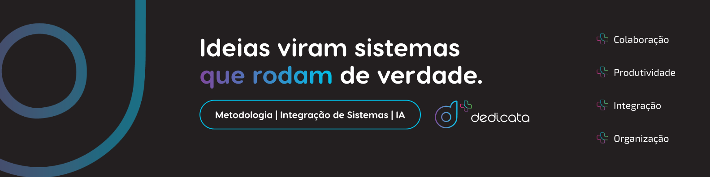

# 🚀 Dedicata - Sua empresa inteira em um só sistema, com método e IA

**Plataforma de gestão integrada, inteligência artificial aplicada e capacitação contínua para empresas que querem crescer com previsibilidade.**

[🌐 Website](https://dedicata.com.br?utm_source=github&utm_medium=referral&utm_campaign=org_profile) • [📧 Contato](mailto:contato@dedicata.com.br) • [💬 WhatsApp (19) 3113-1000](https://wa.me/551931131000)

---

## 📖 Sobre Nós

A **Dedicata** une **método, tecnologia e comunidade** para organizar a gestão de empresas de todos os portes. Em vez de entregar só um software ou só um curso, combinamos um sistema de gestão integrado com IA, uma metodologia de implantação comprovada e o acompanhamento de quem vive a rotina da empresa.

O resultado é uma operação mais organizada, com fechamento de mês, metas e indicadores apoiados por IA, e decisões tomadas com dados em tempo real.

> **Metodologia de Implantação + Sistemas**

---

## 💎 Nossos Pilares

<table>
<tr>
<td align="center" width="33%">
<h3>🧭 Método</h3>
Diagnóstico, implantação e rotina de gestão estruturados para que o sistema gere resultado de verdade, não só seja instalado.
</td>
<td align="center" width="33%">
<h3>🤖 Tecnologia</h3>
Sistema integrado com IA aplicada à operação e às decisões: comercial, financeiro, estoque, projetos, site e BI em um só lugar.
</td>
<td align="center" width="33%">
<h3>🤝 Comunidade</h3>
Os <b>Dedicatos</b>: empresários que trocam experiências, geram negócios entre si e participam de encontros e eventos nacionais.
</td>
</tr>
</table>

---

## 🎯 Nossas Soluções

### [Dedicata Scale Up](https://dedicata.com.br/scale-up?utm_source=github&utm_medium=referral&utm_campaign=org_profile)
Para **donos e líderes de pequenas e médias empresas** que querem substituir várias ferramentas por um único sistema e crescer com previsibilidade.

**O que está incluso:**
- ✅ Plataforma completa, sem versão limitada nem módulos cobrados à parte
- ✅ IA aplicada à rotina de fechamento de mês, metas e indicadores
- ✅ Vertical especializada no segmento da empresa e subdomínio próprio
- ✅ Metodologia de implantação: diagnóstico, configuração, treinamento e entrada no ar
- ✅ Encontros ao vivo e mentorias mensais
- ✅ Área de cursos e acesso à comunidade de Dedicatos

### [Dedicata Corporate](https://dedicata.com.br/corporate?utm_source=github&utm_medium=referral&utm_campaign=org_profile)
Para **multinacionais, grupos com várias empresas e operações com múltiplas unidades** nos setores de indústria, saúde, logística, agro e serviços.

**Entregas:**
- 🏗️ Projeto sob medida, desenhado a partir do diagnóstico
- 🔄 Migração de dados planejada para não parar a operação
- 💳 Cobrança e conciliação bancária integradas
- 🧾 Rotina fiscal com NF-e, NFS-e, NFC-e, NFCom e MDF-e
- 📊 Dashboards executivos com indicadores em tempo real
- 🎓 Treinamento in-company com trilhas de cursos e encontros ao vivo

---

## 📊 Metodologia Dedicata

| 1️⃣ Raio-X | 2️⃣ Implantação | 3️⃣ Sustentação |
|:---:|:---:|:---:|
| Diagnóstico de processos, indicadores, gargalos e maturidade do time | Sistema integrado com IA configurado para a operação, dados migrados e capacitação por área | Acompanhamento com rotina de gestão: fechamento de mês, metas, dashboards e ajustes |

---

## 🏆 Plataforma Parceira Oficial

Nossas soluções são construídas sobre uma **plataforma de gestão líder de mercado**, da qual somos **parceiros oficiais**. Isso garante evolução contínua do produto, estabilidade e um ecossistema completo de módulos.

---

## 📈 Nosso Impacto

| 🏦 **+40** | 🏛️ **+2.200** | 🧾 **5** |
|:---:|:---:|:---:|
| bancos homologados para cobrança | municípios com emissão de NFS-e | tipos de documento fiscal |

---

## 📞 Entre em Contato

### Comece pelo diagnóstico da sua gestão!

📧 **Email:** [contato@dedicata.com.br](mailto:contato@dedicata.com.br)  
💬 **WhatsApp:** [(19) 3113-1000](https://wa.me/551931131000)  
🎓 **Cursos:** [dedicata.com.br/slides](https://dedicata.com.br/slides?utm_source=github&utm_medium=referral&utm_campaign=org_profile)

### 🌐 Redes Sociais

[🚀 SOLICITE SEU DIAGNÓSTICO](https://dedicata.com.br?utm_source=github&utm_medium=referral&utm_campaign=org_profile)

---

**Copyright © Grupo Dedicata**

Parte do Grupo Dedicata, junto com a [IT Brasil](https://github.com/itbrasil-odoo) • [itbrasil.com.br](https://itbrasil.com.br?utm_source=github&utm_medium=referral&utm_campaign=org_profile)

*Método, tecnologia e comunidade para empresas que querem crescer*

